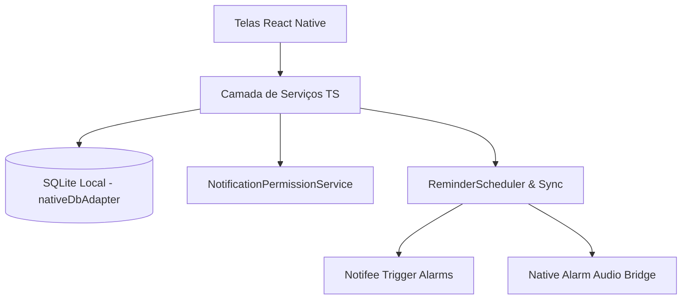

# 01 - Arquitetura e Estrutura do Código

## 🧱 Arquitetura Geral

O Remedin é construído sob uma arquitetura local-first em **React Native + TypeScript**, utilizando integrações e permissões críticas nativas (**Native Modules / Android Services**) para alarmes precisos.

O [README](../README.md) apresenta os pontos de entrada e como repetir a bancada Android.

---

## 📂 Estrutura de Diretórios (`src/`)

### **`src/screens/` (Telas Principais)**
- `HomeScreen`: Visão diária e status principal das doses.
- `DoseAlarmScreen`: Tela de alarme em tela cheia (Full-screen intent) para interações de tomada, salto ou soneca.
- `MedicationsScreen`, `AddMedicationScreen`, `EditMedicationScreen`, `MedicationDetailScreen`: Gestão completa (CRUD) de medicamentos e intervalos de agendamento (interval schedules).
- `HistoryScreen`: Relatórios de adesão diária e logs passados.
- `SettingsScreen`: Gerenciamento de permissões críticas (alarmes exatos, DND, etc).

### **`src/database/` (Persistência)**
- `migrations.ts`: Esquema central. Tabelas incluem: `medications`, `medication_schedules`, `dose_logs`, `notification_mappings`, `app_settings` e `reminder_artifacts`.
- A migração 4 remove os dados do fluxo antigo de login. O banco preserva o perfil local, a rotina e os registros de dose.
- `nativeDbAdapter.ts`: Adapter construído sobre a engine SQLite com filas sequenciais e transações isoladas (evitando concorrência e race conditions).
- `repositories/`: Padrão de repositórios para abstrair consultas diretas.

### **`src/services/` (Lógica de Negócio e Agendamentos)**
- `reminderScheduler.ts`: Motor principal de alarmes. Gera tipos de notificação como `preAlert` (pré-alerta 5 mins antes), `doseAlarm`, `snoozedAlarm` (soneca de 5 minutos), `alarmHandoff` e `reinforcement`.
- `reminderSyncService.ts`: Reconcilia os alarmes do Android com `reminder_artifacts` e consulta o histórico antes de agendar. Permissões e restrições do Android afetam a entrega.
- `notificationPermissionService.ts`: Orquestrador de permissões vitais do Android 12-14+ (Do Not Disturb access, Critical Alarm Channels, Full-screen Intents, Exact Alarms, e Battery Optimization).
- `doseService.ts`: Controla a gravação das ações executadas pelo usuário (`taken`, `skipped`, `snoozed`, `undone`) diretamente na tabela `dose_logs`.

---

## 🤖 Camada Nativa Android
*(Para garantir que a prioridade do alarme sobreponha o bloqueio de tela)*

- **Native Alarm Audio (`nativeAlarmAudio.ts`)**: Aciona o `AlarmAudioScheduler` e o serviço em primeiro plano `MedicationAlarmService` no Android.
- Integrações profundas com permissões usando módulos nativos para solicitar canais de "Critical Alerts" que passem por cima do modo Não Perturbe (DND).
